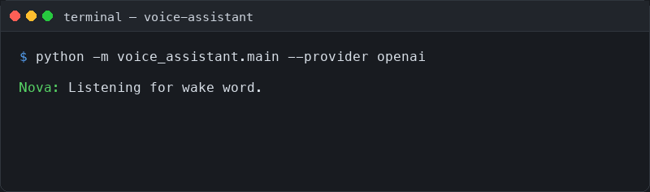
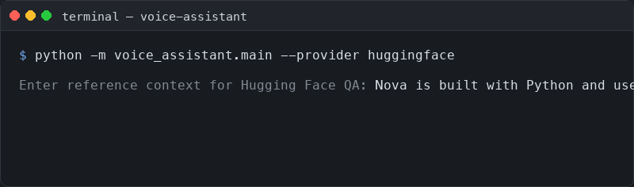

# Voice Assistant (`voice-assistant`)

A modular Python voice assistant pipeline featuring wake-word detection (**Nova**), speech-to-text capture, neural text-to-speech playback, and dual AI backends tailored for distinct tasks: open-ended conversational chat via **OpenAI** and reference-grounded question answering via **Hugging Face**.





## Dual AI Modes

- **OpenAI (`--provider openai`):** Powers general, open-ended conversational replies where Nova answers freely without requiring a reference text.
- **Hugging Face (`--provider huggingface`):** Runs extractive question answering (`deepset/roberta-base-squad2`) over a reference context entered in the terminal at startup so answers stay grounded in that text.

## Features

- **Wake-Word Detection:** Continuously listens for configurable wake phrases (`"wake up nova"`, `"hey nova"`, `"nova"`) before entering an active conversation loop.
- **Speech-to-Text (STT):** Captures microphone input via `SpeechRecognition` with ambient noise calibration and configurable timeouts.
- **Text-to-Speech (TTS):** Synthesizes speech asynchronously with `edge-tts` and plays audio through `pygame`, cleaning up temporary audio files automatically.
- **Greeting Fast-Path:** Matches common greetings and farewells against `config/greetings.json` via `GreetingSystem`.
- **Modular Architecture:** Separates audio I/O (`audio/`), orchestration (`core/`), configuration (`config/`), and model integrations (`models/`) within an installable `src/` package.

## Tech Stack

- **Language:** Python 3.9+
- **Speech & Audio:** `SpeechRecognition`, `PyAudio`, `edge-tts`, `pygame`
- **Model Integrations:** `openai`, `huggingface_hub`
- **Configuration & Packaging:** `python-dotenv`, `setuptools` (`pyproject.toml`)

## Installation

1. **Clone the repository and create a virtual environment:**

   ```bash
   git clone <your-repo-url>
   cd <your-repo-directory>
   python -m venv .venv
   source .venv/bin/activate  # On Windows: .venv\Scripts\activate
   ```

2. **Install system audio dependencies (required for `PyAudio`):**

   - **macOS:** `brew install portaudio`
   - **Ubuntu/Debian:** `sudo apt-get install portaudio19-dev python3-pyaudio`

3. **Install the project in editable mode:**

   ```bash
   pip install -e .
   ```

## Configuration

Create a `.env` file in the project root with your API credentials:

```env
OPENAI_API_KEY=your_openai_api_key_here
HUGGINGFACE_API_KEY=your_huggingface_api_key_here
```

You can customize greeting triggers and replies in `src/voice_assistant/config/greetings.json`.

## Usage

Run the assistant in general chat mode with OpenAI:

```bash
python main.py --provider openai
```

Or run in reference-based QA mode with Hugging Face (you will be prompted to enter the reference context in the terminal):

```bash
python main.py --provider huggingface
```

Say a wake phrase (such as `"Hey Nova"`) to start a turn, and use an exit phrase (`"exit"`, `"quit"`, `"stop"`, `"goodbye"`, `"bye"`, `"sleep"`, or `"shut down"`) to end the session.

## Known Limitations & Roadmap

- **Extractive QA Scope:** The Hugging Face backend (`deepset/roberta-base-squad2`) extracts answers from the provided reference context rather than generating free-form responses outside that text.
- **Unit Testing:** Add automated tests covering wake-word normalization, greeting matching, provider-specific API key validation, context validation, and error handling.
- **Session Context & Voice Options:** Add lightweight conversation history for OpenAI chat sessions and CLI options for voice or language selection.